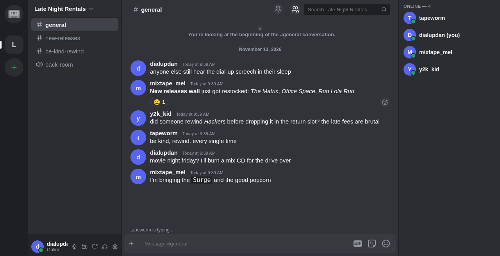

<p align="center">
  
</p>

# RWND

**Be kind, rewind.** Discord, but it lives on your own box.

RWND (once called Cassette) is a group chat you host yourself. If you've used
Discord you already know your way around: servers down the left, channels next
to them, the conversation in the middle, and everyone who's online on the right.
The difference is where it runs. The whole thing is one server process and one
SQLite file, on a machine you own, and the only admin is you.

It's Rust from end to end. The browser client is compiled to WebAssembly with
the [idealyst](https://github.com/IdealystIO/idealyst-native) UI framework, so
there's no JavaScript framework underneath. Client and server share their types
and talk through plain Rust function calls, which means there's no REST API for
the two sides to drift apart on. Anything live, like new messages, typing and
who's online, comes in over a WebSocket.

<p align="center">
  
</p>

## Coming Attractions: where it's heading

It was called Cassette; it's now **RWND** ([rwnd.chat](https://rwnd.chat)), and
it's becoming the front end for [idea-chat](https://github.com/IdealystIO/idea-chat),
a chat and calling backend built on the same idealyst framework.

- **idea-chat brings the backend:** accounts, spaces, channels and messages over
  one live connection, and end-to-end encryption. App state (messages, role
  changes and the like) is a ledger of encrypted commits that every client
  checks against the server's rules, and voice and video are encrypted so the
  relay forwards media it can't read.
- **RWND brings the app people use:** the screens, the settings, the theming and
  the robot test suite. Every screen already talks to one backend interface
  (`discord-clone/src/backend`), so moving from this repo's own server to
  idea-chat is a matter of filling in the other side of that interface. That
  work is in progress.
- **The standalone version stays available.** This repo still ships its own
  server today, and that's what the instructions below run. The state before the
  move started is tagged
  [`standalone-server-2026-11-05`](../../tree/standalone-server-2026-11-05).

## Track Listing: what it does

**Side A: talking**
- Messages land the moment they're sent, and you can see when someone's typing.
  Edit them, delete them, reply to them, react to them, pin the good ones
- Markdown, image uploads, an emoji picker, a GIF picker (bring your own Giphy
  key) and stickers
- Your server's own custom emoji (PNG, JPEG, GIF or WebP), used as `:name:` in
  messages and reactions. Rename one and every old message picks up the new name
- Paste a link and a preview card shows up with the page's title, blurb and image
- `@someone`, `@role`, `@everyone` and `@here`, with autocomplete. Messages that
  mention you light up
- Search a server's whole history and jump straight to the hit
- Come back to a busy channel and a "new messages since…" bar takes you to where
  you left off

**Side B: running a server**
- Start one, share an invite link, and people are in
- Text and voice channels, sorted into categories you can fold away
- Roles with colours and 16 separate permissions, plus per-channel overrides
- Private channels, hidden from everyone you haven't let in
- Kick, ban and time out. You can only do that to people ranked below you, so
  moderators can't gang up on the owner

**Bonus tracks: you**
- A display name, avatar and "about me", plus free avatar decorations (cat ears,
  cassette reels, a halo and more) and animated profile card effects
- Online, Idle, Do Not Disturb or Invisible
- Friends, DMs and group DMs, plus a block button for when you need it
- Browser notifications you control per server and per channel: everything,
  only @mentions, or nothing, or mute for 15 minutes, a day, or until you say so
- Themes straight off the shelf: **Sunset, Miami, Memphis, Bubblegum, Game Boy,
  Windows 95, VHS and Blockbuster**, plus plain Dark, Light and Dark Purple. Pick
  one and RWND offers the matching cassette as its app icon
- Keyboard shortcuts. Press `?` to see them

**Voice and video: the B-side, still being mixed**
- Join a voice channel and you can talk and hear everyone in it, see who's
  speaking, mute your mic, and deafen (which only silences things on your end;
  nobody else is affected)
- Turn your camera on, or share your screen with its sound, and everyone in the
  channel gets a live video tile
- All of it goes through one call-provider interface (`backend/call_media.rs`).
  The provider is moving to idea-chat's encrypted relay, so voice is switched
  off by default until that lands, and voice channels say so

## Liner Notes: what's inside

| Path | What it is |
|---|---|
| [`discord-clone/`](discord-clone) | The client: every screen, style and bit of client state. Compiles to WASM. |
| [`discord-server/`](discord-server) | The backend: the SQLite data layer, the API functions, the WebSocket gateway and image storage. |
| [`discord-server/migrations/`](discord-server/migrations) | The database schema. Each file runs once, in order, when the server starts. |
| [`deploy/`](deploy) | A one-command installer and templates for running RWND as a service. |
| [`docs/`](docs) | The self-hosting guide and the idea-chat wire notes. |

The client pulls in `discord-server` for the types they share. Each `#[server]`
function is written once: in the client build it turns into a typed network
call, and in the server build it's the real handler. In production a single
binary serves the API and the client on one port.

[ARCHITECTURE.md](ARCHITECTURE.md) has the full tour. If you're about to change
something, read [AGENTS.md](AGENTS.md) first. It's the house rules, for people
and AI agents alike.

## Press Play: getting started

### What's in the box (prerequisites)

1. **Rust** (stable) via [rustup](https://rustup.rs/), with the WASM target:
   `rustup target add wasm32-unknown-unknown`
2. The **idealyst CLI 2.0** or newer. See the
   [idealyst README](https://github.com/IdealystIO/idealyst-native#installing-the-cli).
3. **`wasm-bindgen-cli` 0.2.122**, to match the version pinned in
   `discord-clone/Cargo.toml`:
   `cargo install wasm-bindgen-cli --version 0.2.122`

The framework crates (idealyst 9.x) come from the idealyst registry, which is
already configured in [`.cargo/config.toml`](.cargo/config.toml). SQLite is
compiled in (`rusqlite` with `bundled`), so there's no database to install.

### Hit play (run it locally)

From the repository root:

```bash
idealyst dev --web --local discord-clone
```

This builds the client and the server, applies the migrations, and serves
everything at <http://127.0.0.1:8080/> with hot reload. Sign up to create the
first account, then create a server.

Useful options: `--port <n>` changes the port, and `HOST=0.0.0.0` makes it
reachable from other machines on your network.

### Dub a master copy (production build)

```bash
cd discord-clone
idealyst build --web --release
```

### Put it on the shelf (self-hosting)

[`deploy/install.sh`](deploy/README.md) installs RWND as a per-user `systemd`
service in one go: it builds the app, generates the session secret, writes the
settings file and starts the service. [`docs/self-hosting.md`](docs/self-hosting.md)
covers HTTPS, reverse proxies and tunnels. (Its voice sections describe LiveKit,
which RWND no longer uses; voice is moving to idea-chat.)

## DIP Switches: configuration

All settings are read by the server:

| Setting | Purpose |
|---|---|
| `DISCORD_DB` | Path to the SQLite database. Default: `./discord.db`. |
| `MEDIA_DIR` | Where uploaded images are stored. Default: `media/` next to the database. |
| `DISCORD_SESSION_SECRET` | Hex key for signing session tokens. If unset, a random one is created in `<db>.session-secret` (mode 0600) and reused. |
| `PUBLIC_URL` | The address people use to reach the site, e.g. `https://chat.example.com`. Password reset links start with it. Default: `http://localhost:<PORT>`. |
| `TRUSTED_PROXIES` | Comma-separated IP addresses of reverse proxies in front of the server, e.g. `127.0.0.1,::1` for Caddy on the same host. Requests from them are attributed to the client named in `X-Forwarded-For`, so per-IP rate limits still apply. Leave unset when the server is reached directly. |
| `INSTANCE_ADMINS` | Comma-separated usernames who run this instance (its instance-wide settings). |
| `CALL_PROVIDER` | Voice and video. Unset (the default) means voice is off. |
| `GIPHY_API_KEY` | Enables GIF search. Alternatively, put the key in a `giphy.key` file next to the database. |
| `DISCORD_ALLOW_USER_ID_HEADER=1` | Accepts the legacy `x-user-id` header. Only for local test tooling; never enable it in production. |

The database, session secret, media folder and `giphy.key` are all gitignored.

## Lost Your Password? (the reset link)

There's no email, so whoever runs the server makes a reset link and passes it
on. With the same settings as the running server:

```bash
server reset-link <username>
```

It prints a link that works once, for 24 hours. Opening it shows a form for
choosing a new password; using it logs the account out everywhere and lifts any
failed-login lockout. Making a new link cancels the previous one.

## Copy Protection: security

It's your server, so it should be hard to break into.

- Passwords are hashed with PBKDF2-HMAC-SHA256 at 600,000 iterations.
- You stay logged in with a signed token kept in an httpOnly cookie, good for
  12 hours. Changing your password or hitting "Log out of all devices" kills
  every session at once.
- Logins, sign-ups and invite links are rate-limited, and an account locks for a
  bit after too many wrong passwords.
- The server checks every permission itself and never takes the client's word
  for it.
- Link previews won't fetch anything on your own network, so nobody can post a
  link that gets the server to go poking at your router.

The token format, revocation and the exact throttling limits are in
[`discord-clone/README.md`](discord-clone/README.md).

## Quality Control: tests

```bash
cd discord-server && cargo test --features server   # data layer, permissions, gateway round-trip
cd discord-clone && cargo test --lib                # client logic
idealyst test --web discord-clone                   # end-to-end robot suite in a real browser
```

The robot suite (`discord-clone/tests/robot/`) drives the app the way a person
does, with several real browsers signed in as different people for anything
involving more than one user. Voice tests that need a live call provider skip
themselves unless one is configured. [`e2e/README.md`](e2e/README.md) explains
how to run it.

## The Fine Print: license

MIT or Apache-2.0, whichever you prefer. Both are declared in each crate's
`Cargo.toml`.
